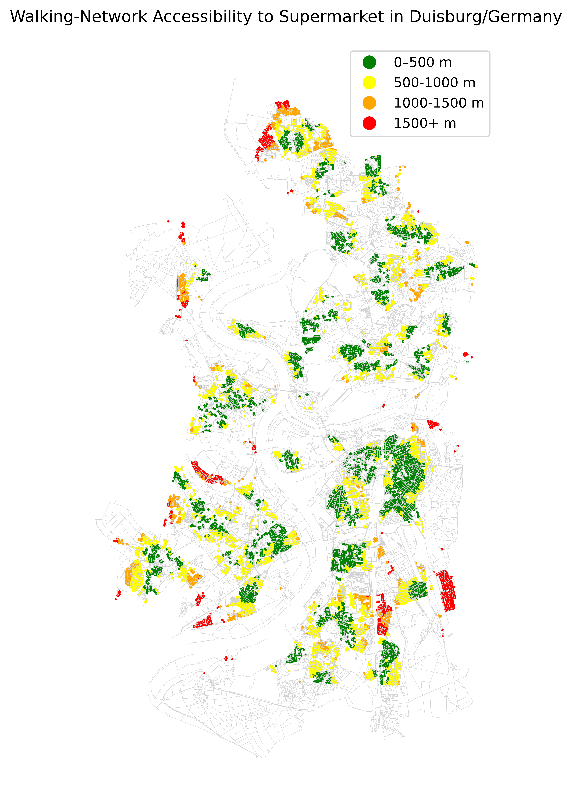
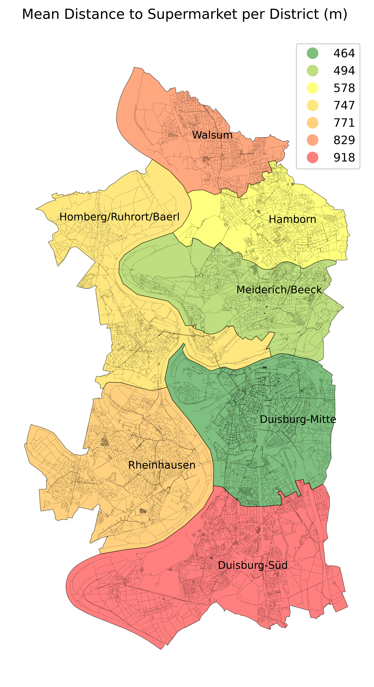

# Walking Accessability Anaysis from Buildings to Supermarkets (Open-Street-Maps)

# Highlights 

You ever wondered how far each citizen in your city has to walk to the nearest supermarket? This project makes it possible to establish an understanding of the walking distances for every residential building existing within the corresponding city boundary to its nearest supermarket. It derives the residential buildings, supermarkets and the cities pedestrian network, cleans and manages OMS-derived datasets, links the nearest nodes of each building and supermarket and computes the shortest-path distances with the help of the walking graph. 

The main script is accessible in the notebook: `Spatial_Network_Analyis_Duisburg_Final.ipynb`

 

# Research Question

1. How far is the walking distance of every residential building in town to the nearest supermarket?
2. What district has on average the closest distance to the supermarkets? 

 

# Tools and Packages
- Python
- Pyrosm
- NetworkX
- OSMnx
- GeoPandas
- pandas
- Matplotlib
- NumPy
- pathlib
- itertools

 

# Data
Data was extracted from OpenStreetMap with Pyrosm. In order to retrieve solely on residential buildings, a combination of tags were utilized during the process of download. 

**Transparancy disclaimer**

1. It is important highlight that these tags do not claim to cover every existing residential building, but display the biggest proportion of them.
2. OpenStreetMap is a collaboration project maintained by a community of volunteers. Having this in mind, data can change of the course of time and with this the results as well. 

 

# Method
1. Define Input and Output Directory
2. Download and create a graph within the boundaries of Duisburg (`network_type = walk`).
3. Project the graph to an appropriate UTM (Zone 32N / EPSG:32632).
4. Retrieve residential buildings and supermarkets by the boundary of Duisburg.
5. Transform geometry of buildings and supermarkets to points with `.geometry.representative_point()` and snap each to the nearest node available.
6. Calculate shortest weighted path length with NetworkX `multi_source_dijkstra_path_length()`
7. Categories the results for better interpretation and `plot()` them.

 

# Results
**How far is the walking distance of every residential building in town to the nearest supermarket?**

| Distance to Supermarket | Number of Buildings | Share of Percent (%) |
| :---------------------- | ------------------:| --------: |
| 0 – 500 m      | 18295     | 43.6       |
| 500 - 1000 m   | 16566     | 39.5       |
| 1000 - 1500 m  | 4005      | 9.5        |
| 1500+ m        | 3082      | 7.3        |
| **Total**      | **41948**     | **100**        |

 

**What district has on average the closest distance to the supermarkets?**

| Districts of Duisburg| Mean Distance (m) to Supermarket |
| :--------------------| --------------------------------:|
| Duisburg-Mitte       | 494                              |
| Meiderich/Beeck      | 578                              |
| Hamborn              | 747                              |
| Homberg/Ruhrort/Baerl| 771                              |
| Rheinhausen          | 829                              |
| Duisburg-Süd         | 918                              |

## Visual Results

 

## Walking Network Accessibility Analysis of each residential Building to Supermarkets

 

## Average Dinstance in Meter of each District in Duisburg

## Author

Master Degree in Environmental Science with the Specialization of Geoinformatics and Remote Sensing. I am a huge OSM-Enthusiast and deeply faszinated by the sheer endless possibilities that came with it. 

## References 
This project / workflow was developed using concepts and materials from:
1. [Automating GIS processes](https://autogis-site.readthedocs.io/) course provided by the University of Helsinki.
2. [GitHub Repository](https://github.com/omaewamoushindei/osm-network-accessibility-munich) Network accessibility munich. 

